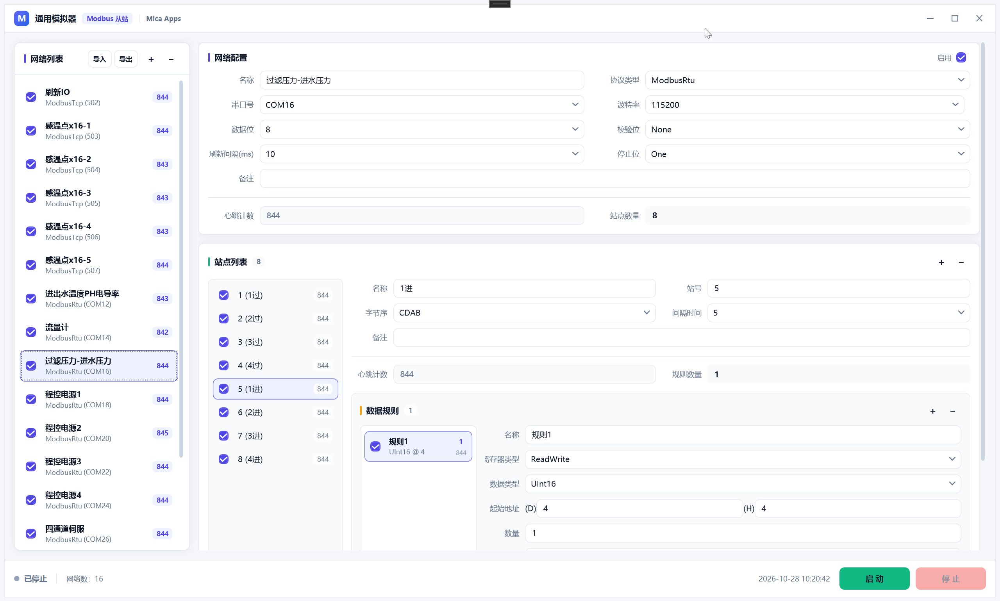

# Modbus 从站模拟器

基于 WPF 的 **Modbus 从站（Slave）模拟器**：用「网络 → 站点 → 数据规则」三层结构描述一台或多台设备，按设定周期自动向寄存器写入随机数据，供上位机 / 主站（Master）连接调试；也提供手动写入窗口，用于精确写入指定地址。

- 支持 `ModbusRtu`（串口）、`ModbusTcp`（TCP 服务端）、`ModbusRtuOverTcp`（串口服务器透传）三种链路，可多网络并行
- 站点列表以 `站号 (名称)` 显示（如 `1 (站点1)`），改站号或名称时即时刷新
- 配置自动保存到 `%LOCALAPPDATA%\Modbus从站模拟器\Setting.json`，支持导入 / 导出
- 无真实 PLC / 仪表时，用它冒充从站，验证主站的采集逻辑、字节序与地址映射

详细的功能说明、数据模型、运行机制见 **[docs/通用模拟器.md](docs/通用模拟器.md)**。



> 界面布局：标题栏左侧为应用名 / `Modbus 从站` 徽章 / 组织名 `Mica Apps`；左侧网络列表（可导入 / 导出参数），右侧上半为网络配置，下半为站点列表与数据规则（站点列表项形如 `1 (1进)`）；底部右侧显示实时日期时间与启动 / 停止按钮。

---

## 下载与安装

在仓库右侧 **Releases** 中下载最新版安装包：

```
Modbus从站模拟器-v<版本>-Setup.exe
```

双击运行即可，安装向导会：

1. 默认安装到 `C:\Program Files\Modbus从站模拟器`（可修改）
2. 自动创建**桌面快捷方式**与开始菜单程序组
3. 若检测到旧版本，会提示并**自动升级**（沿用原安装目录，先静默卸载旧版再安装）

卸载：开始菜单 → `Modbus从站模拟器` → 卸载，或「设置 → 已安装的应用」中卸载。

> 运行需要 **.NET 10 运行时**；若目标机器未安装，请先到 [dotnet.microsoft.com](https://dotnet.microsoft.com/download) 下载 .NET 10 Desktop Runtime。
> 监听 502 端口在 Windows 下可能需要管理员权限，建议先用 5020 之类端口测试。

---

## 从源码构建

```bash
dotnet build 通用模拟器/通用模拟器.csproj -c Release
dotnet run --project 通用模拟器/通用模拟器.csproj
```

生成安装包（需要本机安装 [NSIS](https://nsis.sourceforge.io/)）：

```powershell
dotnet publish 通用模拟器/通用模拟器.csproj -c Release -o publish /p:DebugType=none
makensis /DAPP_VERSION=1.0.0.0 /DPUBLISH_DIR="$PWD\publish" /DOUTFILE="$PWD\Setup.exe" installer/setup.nsi
```

---

## 自动发布

推送到 `main` / `master` 会自动触发 `.github/workflows/release.yml`：编译 → 读取程序集版本号 → 用 NSIS 生成同名版本号的安装包 → 上传构件并创建 GitHub Release（标签 `v<版本>`）。

---

## 目录结构

```
README.md                      本文件（下载安装 / 构建 / 发布）
LICENSE                        MIT 许可证
docs/通用模拟器.md               详细文档（功能、数据模型、运行机制）
docs/images/main-window.png    主界面截图（README / 文档引用）
installer/setup.nsi            NSIS 安装脚本（中文界面、桌面快捷方式、支持升级）
.github/workflows/release.yml  推送即构建并发 Release
通用模拟器.slnx
└─ 通用模拟器/                  WPF 应用工程
```

---

## 许可证

[MIT](LICENSE)
