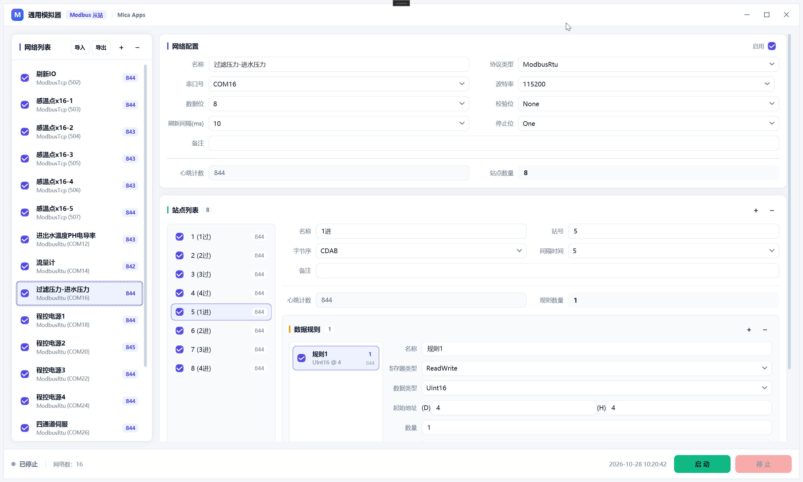

# Modbus 从站模拟器

基于 WPF 的 **Modbus 从站（Slave）模拟器**：用「网络 → 站点 → 数据规则」三层结构描述一台或多台设备，按设定周期自动向寄存器写入随机数据，供上位机 / 主站（Master）连接调试；也提供手动写入窗口，用于精确写入指定地址。

- 支持 `ModbusRtu`（串口）、`ModbusTcp`（TCP 服务端）、`ModbusRtuOverTcp`（RTU over TCP 监听，主站工具直连）三种链路，可多网络并行
- 三种数据规则：**生成随机数**（可指定数量连续写入）、**伺服流量泵**（量程映射 + 一阶惯性 + 纯滞后）、**值拷贝**（支持一对一 / 一对多 / 多对多，源与目标均可设缩放偏置）
- 规则可读写本站或其它网络的从站；跨网络读写时字节序跟随对应从站自身设置，无需在规则中重复配置
- 站点列表以 `站号 (名称)` 显示（如 `1 (站点1)`），改站号或名称时即时刷新
- 详情区按分组框 / 可折叠分区组织，规则参数分段展开，运行期可选中查看但不可编辑
- 配置自动保存到 `%LOCALAPPDATA%\Modbus从站模拟器\Setting.json`，支持导入 / 导出
- 无真实 PLC / 仪表时，用它冒充从站，验证主站的采集逻辑、字节序与地址映射

详细的功能说明、数据模型、运行机制见 **[docs/通用模拟器.md](docs/通用模拟器.md)**。



> 界面布局：标题栏左侧为应用名 / `Modbus 从站` 徽章 / 组织名 `Mica Apps`；左侧网络列表（可导入 / 导出参数），右侧为可折叠的详情区（网络配置、站点信息、规则参数分段），底部右侧显示实时日期时间与启动 / 停止按钮。

---

## 下载与安装

在仓库右侧 **Releases** 中下载最新版安装包：

```
Modbus从站模拟器-v<版本>-Setup.exe
```

双击运行即可，安装向导会：

1. 默认安装到 `C:\Program Files\Modbus从站模拟器`（可修改）
2. 自动创建**桌面快捷方式**与开始菜单程序组
3. 若检测到旧版本，会提示并**自动升级**（沿用原安装目录，先静默卸载旧版再安装）

卸载：开始菜单 → `Modbus从站模拟器` → 卸载，或「设置 → 已安装的应用」中卸载。

> 运行需要 **.NET 10 运行时**；若目标机器未安装，请先到 [dotnet.microsoft.com](https://dotnet.microsoft.com/download) 下载 .NET 10 Desktop Runtime。
> 监听 502 端口在 Windows 下可能需要管理员权限，建议先用 5020 之类端口测试。

---

## 从源码构建

```bash
dotnet build 通用模拟器/通用模拟器.csproj -c Release
dotnet run --project 通用模拟器/通用模拟器.csproj
```

生成安装包（需要本机安装 [NSIS](https://nsis.sourceforge.io/)）：

```powershell
dotnet publish 通用模拟器/通用模拟器.csproj -c Release -o publish /p:DebugType=none
makensis /DAPP_VERSION=1.0.0.0 /DPUBLISH_DIR="$PWD\publish" /DOUTFILE="$PWD\Setup.exe" installer/setup.nsi
```

---

## 自动发布

推送到 `main` / `master` 会自动触发 `.github/workflows/release.yml`：编译 → 读取程序集版本号 → 用 NSIS 生成同名版本号的安装包 → 上传构件并创建 GitHub Release（标签 `v<版本>`）。

---

## 更新日志

### 2026-11-23

- 修复停止网络时误报“监听异常终止”：停止释放网络时，TCP 的 `AcceptTcpClientAsync` 被取消、串口 `ModbusSerialTransport.DiscardInBuffer()` 访问已释放 transport 会抛异常，原逻辑不区分“运行期意外终止”与“停止收尾”，一律上报红色错误。`OnListenerError` 现用 `released` 标记识别停止/释放流程，此类异常只记普通日志、不上报也不触发重建；运行期真实异常逻辑不变。
- 修复改动集合（增删网络/站点/规则）时偶发“集合已修改，枚举操作无法执行”与“索引超出范围”：AppLogger 投递给 UI 的日志批次改为不可变快照（原实现后台复用同一 List，UI 枚举时后台仍在 Clear/Add）；`FindStationByGuid`、`RefreshStationTargets`、`OnCanEditChanged`、`Dispose`、`ModelClipboard.Changed` 等后台/事件路径全部改用 `.ToArray()` 快照遍历并加 `RefreshStationTargets` 重入守卫；`Move*` 操作移除后重算并钳制索引、插入失败回滚；串口下拉刷新延迟到 Dispatcher 空闲执行；`AddStation`/`AddRuler` 补 `CanExecute=CanEdit` 防止运行期编辑与后台写入竞争。
- 修复旧版 `.lsts` 配置导入抛异常：旧版导出文件含下拉选项字段（网络 `IntervalValues`/`ProtocolTypeValues`/`BaudRateValues` 等、站点 `IntervalValues`/`EndialValues`、规则 `RegisterTypeValues`/`DataTypeValues`），当前版本已把这些属性改为只读静态缓存，但未标记 `[JsonIgnore]`，Newtonsoft.Json 反序列化时会尝试向只读数组填充而抛异常；现已全部标记跳过序列化，并清理了旧的 `四通道流阻热阻测试V1.lsts`（原文件另存为 `.bak`）。导入改为「先对新配置补齐 ID 并校验，通过后再整体替换、旧对象最后释放」，导入与启动加载异常只记录日志（启动加载不再弹窗阻断），不会破坏当前正在使用的配置。
- 性能优化：日志改为内存队列 + 单后台线程每 200ms 批量落盘、相同消息 1 秒内限流（消除高频错误时的同步磁盘 IO 与 UI 编组风暴）；从站监听异常终止时自动标记并在下一周期重建；Tick 刷新只在运行时启用且按可见范围刷新（全部网络项 + 选中网络的全部站点项 + 选中站点的全部规则项）；网络/站点名称与站号改为失焦提交、下拉选项集合保持实例稳定；Converter 反射与参数解析结果缓存。退出时等待日志刷盘。
- UI 刷新周期由 100ms 调整为 200ms，降低界面更新频率。
- 三级列表（网络/站点/规则）右键菜单新增「删除」项；菜单项禁用时以灰度+斜体+半透明明显区分，并提示"当前状态不可操作"。站点/规则删除同步受运行期锁定限制（运行中不可删除）。
- 值拷贝源位置新增「固定值」选项：无需从站读取，只需填写一个字符串。按目标数据类型解析——Bool 支持 `true/false`、`1/0`（不区分大小写），整数/浮点先按浮点数解析再转换为目标类型；解析失败会在启动前校验拦截并写入日志。固定值源下隐藏源网络/从站/区/类型/地址，仍保留源数量、源缩放/偏置。该选项仅值拷贝支持，伺服流量泵的下拉不含此项。
- 新增日志显示与文件记录：底部可折叠「运行日志」面板实时显示时间、日志类型（消息 / 提醒 / 异常）与产生日志的方法名，按类型着色；日志按天写入 `%LOCALAPPDATA%\Modbus从站模拟器\Logs\log-yyyyMMdd.txt`，最多保留最近 500 条显示，可一键清空。网络启停、配置保存、全局异常、运行期错误与规则读取失败等均已接入。
- 三级列表（网络 / 站点 / 规则）新增右键「复制 / 粘贴」：复制把快照存入内存剪贴板（不改动原对象与列表），粘贴前按类型校验、类型不符时菜单项直接不可用；一次复制可多次粘贴，各副本互不共享引用。站点粘贴会自动分配未占用站号，站号耗尽时弹窗提示。
- 修复浮点参数无法输入小数：缩放、偏置、量程与时间常数等 `double` 字段改为失焦时提交，避免输入 `1.` / `-0` 这类中间态时被立即解析并回写，导致小数点或负号被吞掉。
- 修复停止后再启动卡死：启动时重置网络的释放标记，上一轮停止留下的 `released=true` 不再会让新建的从站网络被误判为已释放而立刻销毁；停止命令同时禁止并发执行，避免重复取消与释放。
- 统一负值写入策略：缩放 / 偏置均为浮点数且允许为负，当计算结果为负而目标为无符号寄存器时，生成随机数规则也统一钳制到 0，不再环绕成 `65535` / `4294967295`。

### 2026-11-21

**界面与交互**
- 右侧详情区改用 `GroupBox` / 可折叠 `Expander` 组织：网络配置、站点信息，以及规则的基本信息 / 输入来源 / 值拷贝参数 / 输出参数 / 水泵流量计参数 / 备注与运行状态分段展示，显著缩短页面长度。
- 运行期规则详情不再整体禁用：可选中并展开分组查看参数，但输入控件保持只读（由站点锁定状态同步控制）。
- `Expander` 箭头随展开状态切换（`▾` / `▴`）。

**规则能力**
- 值拷贝：源参数与目标参数分别成框，均支持缩放与偏置；修正目标数量越出网格行导致的显示异常；源数量 = 1 时目标数量 0 = 不拷贝、1 = 点对点、>1 = 连续写多份；源数量 > 1 时按源数量多对多拷贝。
- 生成随机数：新增「数量」字段，每次生成指定数量并从起始地址连续写入；输出目标可选本站或其它网络从站。
- 字节序：规则层不再单独设置，读写其它网络从站时直接使用该从站自身的字节序配置。
- 伺服流量泵：目标缩放 / 目标偏置移到「输出参数与目标」分组底部。

**稳定性与校验**
- 修复网络创建与释放竞态：停止过程中才创建完成的网络会被立即释放，不会在释放后重新挂上。
- 单条规则执行异常被隔离，不再中断同网络后续站点与规则的本周期执行。
- 地址范围校验按数据类型字长计算（32 位整数与浮点占 2 个寄存器），避免接近 65535 时越界。
- 启动前统一校验：跨网络 GUID 引用有效性、网络 / 站点刷新间隔；伺服流量泵拒绝 String 输出、要求上限大于下限、滞后时间限制在 0~3600 秒。
- 修复启动前 GUID 校验误报：不再依赖运行期才创建的 `Slave` 对象。

> 更完整的问题分析与修复状态见 [项目问题分析报告](项目问题分析报告.md)。

---

## 目录结构

```
README.md                      本文件（下载安装 / 构建 / 发布 / 更新日志）
项目问题分析报告.md               问题清单、修复状态与待确认项
LICENSE                        MIT 许可证
docs/通用模拟器.md               详细文档（功能、数据模型、运行机制）
docs/images/main-window.png    主界面截图（README / 文档引用）
installer/setup.nsi            NSIS 安装脚本（中文界面、桌面快捷方式、支持升级）
.github/workflows/release.yml  推送即构建并发 Release
通用模拟器.slnx
└─ 通用模拟器/                  WPF 应用工程
```

---

## 许可证

[MIT](LICENSE)
